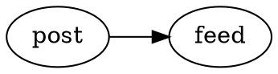

This post uses every block and inline feature of the Markdown dialect, so a
theme can show how it styles each one.[^why]

| Part   | Shows                            |
| ------ | -------------------------------- |
| Text   | inline markup, lists and quotes  |
| Blocks | code, tables, maths and diagrams |

<!--more-->

## Inline text

Plain text with `inline code`, a [link to another post](2023-06-01-short-note.md), an
[external link](https://example.com/docs/), ~~struck-through text~~ and an
autolink: <https://example.com/a/very/long/path/that/must/wrap/on/a/narrow/screen/without/scrolling>.
A long word: Donaudampfschifffahrtsgesellschaftskapitänswitwenrentenversicherung.

## Lists

- A first item
- A second item with `code`
- A third item

1. Step one
2. Step two
3. Step three

### Tasks

- [x] Write the content
- [ ] Review the theme
- [ ] Publish the site

## Quotation

> A quotation can hold several paragraphs.
>
> This is the second one, with a [link](https://example.com/).

## Code

```nim
proc greet(name: string): string =
  ## A short procedure.
  result = "Hello, " & name & "!"

echo greet("world")
```

## Table

| Feature   | Markdown   | Notes                              |
| --------- | ---------- | ---------------------------------- |
| Code      | backticks  | inline and fenced                  |
| Tables    | pipes      | scroll inside themselves if narrow |
| Footnotes | `[^label]` | numbered in order of reference     |

: How three features are written

A wide table must fit a narrow screen too:

| Release | Date       | Platforms                      | Highlights                                  | Archive                                      |
| ------- | ---------- | ------------------------------ | ------------------------------------------- | -------------------------------------------- |
| 1.0     | 2024-01-10 | Linux, macOS, Windows, FreeBSD | The first stable release with every feature | releases/1.0/example-1.0-x86_64-linux.tar.gz |

## Maths and diagrams

Inline maths, such as $e^{i\pi} + 1 = 0$, sits in the line of text. A
display formula stands on its own:

$$
\sum_{k=1}^{n} k = \frac{n(n+1)}{2}
$$

A display formula wider than a narrow screen scrolls inside its own box:

$$
f(x) = a_0 + a_1 x + a_2 x^2 + a_3 x^3 + a_4 x^4 + a_5 x^5 + a_6 x^6 + a_7 x^7 + a_8 x^8 + a_9 x^9 + a_{10} x^{10}
$$

A diagram in D2:

```d2
draft -> post: publish
```

And one in Graphviz:



## Asides

:::note
An aside sets a remark apart from the main text.
:::

:::warning
A warning is an aside too.
:::

#### A fourth-level heading

The last paragraph refers to a second footnote.[^second]

[^why]: Every feature in one place makes a theme easy to review.

[^second]: Footnotes link back to where they were referenced.
